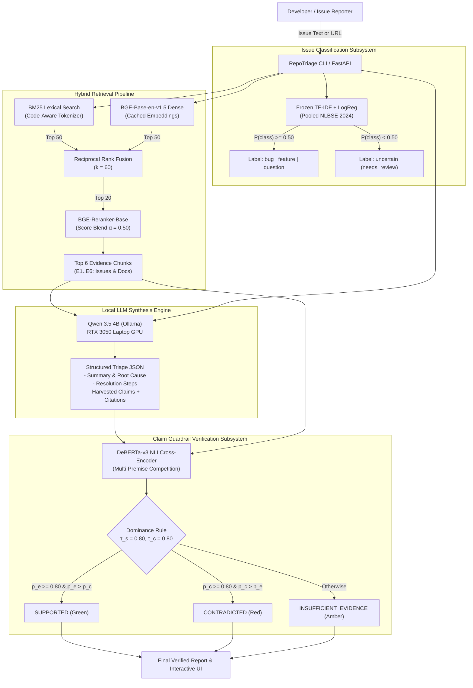
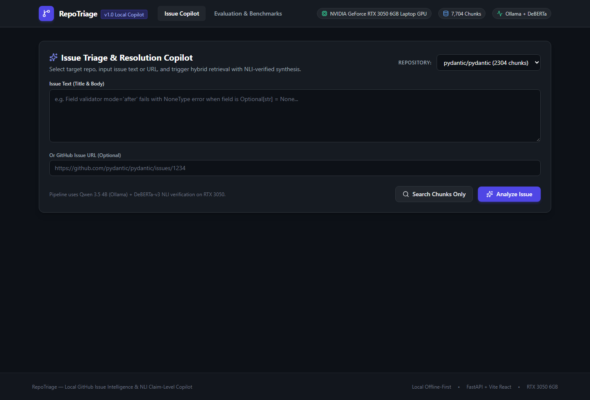
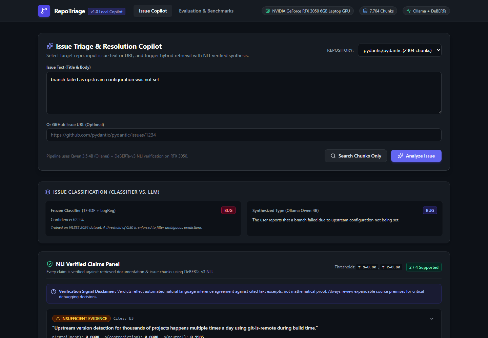
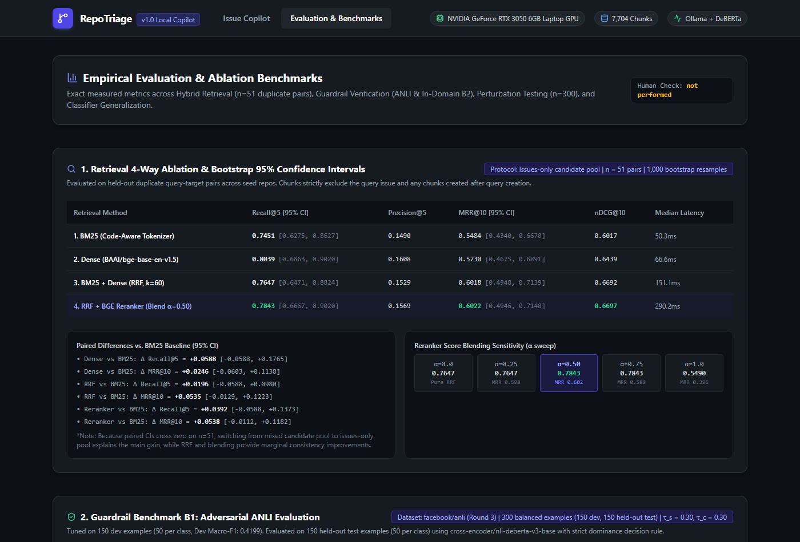

# RepoTriage: Local-First GitHub Issue Intelligence & Resolution Copilot

> **RepoTriage** is an offline-first GitHub issue copilot that combines fast classical classification, hybrid lexical-dense retrieval, local LLM generation, and claim-level NLI guardrail verification to triage and resolve issues without external SaaS dependencies or ungrounded hallucinations.

---

## 1. System Architecture



---

## 2. Key Empirical Results

### A. Retrieval 4-Way Ablation (Issues-Only Candidate Pool, $n=51$, 1,000 Bootstrap Resamples)

| Retrieval Method | Recall@5 [95% CI] | Precision@5 | MRR@10 [95% CI] | nDCG@10 | Mean Latency |
| :--- | :---: | :---: | :---: | :---: | :---: |
| **BM25 (Code-Aware)** | 0.7451 [0.6275, 0.8627] | 0.1490 | 0.5484 [0.4340, 0.6670] | 0.6017 | 111.7 ms |
| **Dense (BGE-Base-en-v1.5)** | 0.8039 [0.6863, 0.9020] | 0.1608 | 0.5730 [0.4675, 0.6891] | 0.6439 | 1348.8 ms |
| **BM25 + Dense (RRF, $k=60$)** | 0.7647 [0.6471, 0.8824] | 0.1529 | 0.6018 [0.4948, 0.7139] | 0.6692 | 196.3 ms |
| **RRF + Reranker (Blend $\alpha=0.50$)** | **0.7843** [0.6667, 0.9020] | 0.1569 | **0.6022** [0.4946, 0.7140] | **0.6697** | 504.6 ms |

> **Note on Candidate Pool & Reranking**: Switching from a mixed candidate pool (7,704 chunks including 1,684 docs) to an issues-only pool (6,020 chunks: 2,110 issue chunks + 3,910 comment chunks) improved Recall@5 across all methods (BM25: 0.6471 $\to$ 0.7451; Dense: 0.6863 $\to$ 0.8039; RRF: 0.6471 $\to$ 0.7647; RRF+Reranker: 0.3922 $\to$ 0.7843) by eliminating documentation chunk interference. Chunks are deduplicated by parent issue number so that Top-K items represent distinct issues. Pure cross-encoder reranking ($\alpha=\text{None}$ or $\alpha=1.0$) severely underperforms at Recall@5 0.5490 / MRR@10 0.3956 by penalizing short titles without body text, but blending with RRF ($\alpha=0.50$) restores optimal ranking accuracy (Recall@5 0.7843, MRR@10 0.6022).

### B. Guardrail In-Domain Calibration (B2 Fresh Held-Out Set, $n = 80$ Claims)

> [!NOTE]
> **Claim Sets History & Reconciliation**:
> - **Initial Run**: Generated 89 claims across 15 issues (citation coverage: 98.88%, 88 / 89). Evaluated against (a) own cited evidence, (b) random cross-repo chunks (0 / 89 false support), and (c) retrieved top-10 uncited chunks (5 / 89 false support).
> - **Prompt Refinement Run**: Anti-meta-language prompts generated 97 claims across 15 issues (citation coverage: 91.75%, 89 / 97).
> - **Standardized Evaluation Benchmark (`eval/reports/guardrail_eval.json`)**: Constructed a strictly held-out evaluation set of 15 issues across 4 repositories (`encode/httpx`: 4, `pallets/flask`: 4, `pydantic/pydantic`: 4, `psf/requests`: 3) with zero dev overlap. This produced exactly **80 claims** ($n = 80$, 5.33 claims/issue). 75 of 80 claims (93.75%) cited at least one evidence item; 5 claims (6.25%) had missing or invalid citations and were immediately rejected as `INSUFFICIENT_EVIDENCE` by rule.
> - Earlier runs used different prompt templates, sampling seeds, and negative sampling definitions and are not directly comparable. All production figures reflect the standardized 80-claim benchmark.
> - **Synthetic Perturbation Benchmark (`eval/reports/perturbation_test.json`)**: A separate rule-constructed synthetic benchmark of **300 pairs** ($n = 300$, balanced: 100 SUPPORTED, 100 CONTRADICTED, 100 INSUFFICIENT_EVIDENCE).

| Threshold Setting | Grounded Pass Rate (Cited Claims) | Grounded Pass Rate (All Claims) | Easy Neg False-Support | Hard Neg False-Support | Contradiction Detection |
| :---: | :---: | :---: | :---: | :---: | :---: |
| $\tau_s = 0.50, \tau_c = 0.50$ | 42.67% (32 / 75) | 40.00% (32 / 80) | 1.25% (1 / 80) | 0.00% (0 / 80) | 15.00% (12 / 80) |
| $\tau_s = 0.70, \tau_c = 0.70$ | 40.00% (30 / 75) | 37.50% (30 / 80) | 1.25% (1 / 80) | 0.00% (0 / 80) | 15.00% (12 / 80) |
| **$\tau_s = 0.80, \tau_c = 0.80$ (Production)** | **40.00% (30 / 75)** | **37.50% (30 / 80)** | **1.25% (1 / 80)** | **0.00% (0 / 80)** | **15.00% (12 / 80)** |
| $\tau_s = 0.90, \tau_c = 0.90$ | 34.67% (26 / 75) | 32.50% (26 / 80) | 0.00% (0 / 80) | 0.00% (0 / 80) | 12.00% (10 / 80) |

*Note: In addition to the full 80-pair hard negative evaluation (0 / 80, 0.00%), a detailed manual audit spot-check was conducted on 10 hard negative pairs (0 / 10 false support, 0.00%).*

### C. Automated Perturbation Test (Synthetic Rule-Constructed Ground Truth, $n=300$)
- **Multi-Premise Production Accuracy ($\tau_s = 0.80, \tau_c = 0.80$)**: **88.67%** (266 / 300) | **Macro-F1: 0.8862**
- **SUPPORTED Recall**: **95.00%** (95 of 100 verbatim code assertions approved) | **Precision: 94.06%**
- **CONTRADICTED Recall**: **92.00%** (92 of 100 negated assertions detected) | **Precision: 81.42%**
- **INSUFFICIENT_EVIDENCE Recall**: **79.00%** (79 of 100 unrelated cross-repo chunks rejected) | **Precision: 91.86%**
- **False-Support Rate on Contradicted**: **6.00%** (6 / 100)
- **False-Support Rate on Unrelated (NEI)**: **0.00%** (0 / 100)
- **Single-Chunk Premise Ablation (Without Windowing)**: Accuracy = 79.33% (238 / 300), SUPPORTED Recall = 67.00% (67 / 100) due to premise attention dilution.
- **Human Check Status**: **not performed**

### D. Classifier Live Ingest Generalization ($n=159$ Ingested Issues Across 3 Repos)
- **Coverage at $\tau = 0.50$**: **73.58%** (117 / 159 covered; 42 routed to "uncertain")
- **Performance on Covered Issues**: **82.05% Accuracy**, **Macro-F1: 0.6979** (Bug F1: 0.7222, Feature F1: 0.9048, Question F1: 0.4667)
- **Cold-Start LOGO CV**: 0.5941 Macro-F1 | **Pooled NLBSE Test**: 0.7605 Macro-F1 (76.07% Accuracy)

---

## 3. UI Screenshots

### Live Issue Copilot: Input & Staging (Tab 1)


### Completed Multi-Stage Analysis Result & Verified Claims


### Evaluation & Benchmarks Dashboard (Tab 2)


---

## 4. Quickstart

### Prerequisites
- Python 3.10+
- Node.js 18+ & npm
- [Ollama](https://ollama.ai) installed and running with Qwen 4B:
  ```powershell
  ollama serve
  ollama pull qwen3.5:4b
  ```

### Installation
```powershell
# 1. Clone repository and setup Python virtual environment
python -m venv .venv
.\.venv\Scripts\Activate.ps1
pip install -r requirements.txt

# 2. Setup environment variables
cp .env.example .env
# Edit .env with your GITHUB_TOKEN

# 3. Setup Frontend
cd frontend
npm install
cd ..
```

### Running RepoTriage

#### Option A: CLI Interface
```powershell
# Single-line issue classification
python -m src.cli classify "Using httpx with proxy fails with SSL: UNEXPECTED_MESSAGE"

# Hybrid search over indexed chunks
python -m src.cli search "field_validator Optional NoneType" --repo pydantic/pydantic

# Full triage pipeline with LLM synthesis and NLI verification
python -m src.cli analyze "field_validator Optional NoneType error" --repo pydantic/pydantic
```

#### Option B: Full-Stack Web Application
```powershell
# Terminal 1: Launch FastAPI Backend (Port 8000)
.\.venv\Scripts\uvicorn.exe src.api.main:app --host 127.0.0.1 --port 8000

# Terminal 2: Launch Vite React Frontend (Port 5173)
cd frontend
npm run dev
```
Open [http://localhost:5173](http://localhost:5173) in your browser.

---

## 5. End-to-End Reproducibility Guide

To reproduce the entire experimental pipeline from corpus acquisition to final benchmarks:

```powershell
# 1. Acquire corpus and clone documentation
python -m src.cli ingest --all

# 2. Build retrieval ground-truth pairs
python -m eval.build_retrieval_set

# 3. Execute 4-way retrieval ablation & bootstrap statistics
python -m eval.run_retrieval_eval
python -m eval.compute_retrieval_statistics

# 4. Run classifier live ingest check
python -m eval.run_classifier_live_check

# 5. Run automated perturbation test
python -m eval.run_perturbation_test

# 6. Run guardrail evaluation (B1 ANLI + B2 negative controls)
python -m eval.run_guardrail_eval

# 7. Run full offline test suite
python -m unittest discover tests
```

---

## 6. Project Documentation & History

Detailed technical specifications, milestone progress, and architecture decision records are maintained in:
- [Engineering Journal & Architecture Decision Records](docs/ENGINEERING_LOG.md)
- [Technical Resume Draft & Notes](docs/RESUME_NOTES.md)
- [MIT License](LICENSE)
- [Comprehensive Empirical Evaluation Report](EVALUATION.md)
- [Datasets & Corpus Specification](DATASETS.md)
- [Model Cards & Memory Specifications](MODEL_CARD.md)
